<h1 align="center">Ishaara</h1>

<p align="center"><b>An AI agent for Android that uses your phone's apps for you.</b></p>

Tell Ishaara what you want, by typing or by voice, in English or any major Indian language. It plans the job as a checklist and does each step in your real apps, the way you would: reading the screen, tapping, typing and scrolling. It checks that each step worked and retries if it didn't.

> "Compare the price of Amul Taaza milk on Zepto, Blinkit and Instamart"
> "Show me Uber fares to Dadar station"
> "Open Google and YouTube in split screen"
> "Fill this form on my screen"

<p align="center">
  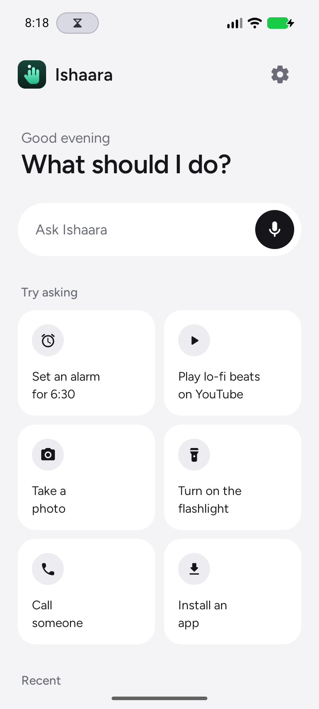
  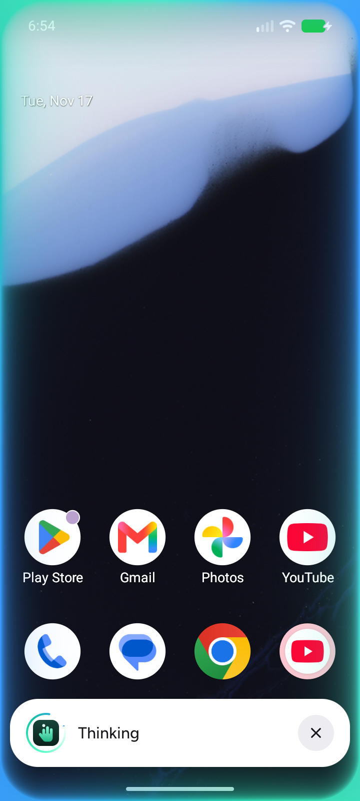
  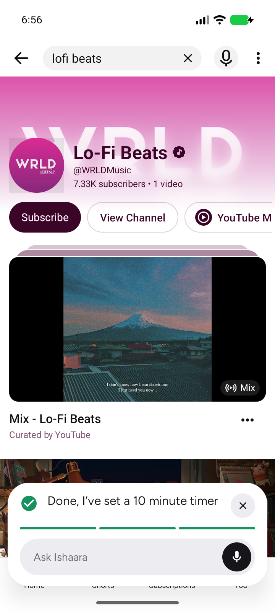
  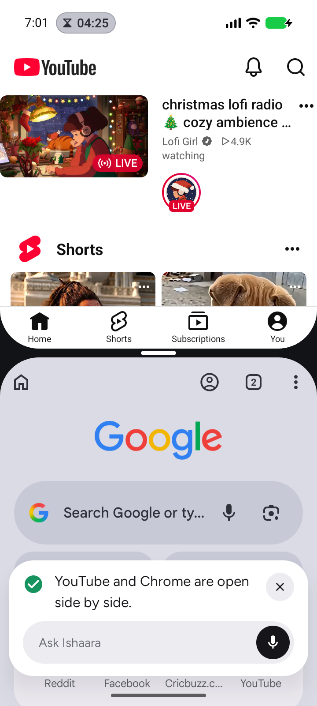
</p>

## Download

Get the latest APK from the [Releases](../../releases) page and install it on an Android 11+ phone. Your phone will ask you to allow installs from your browser or file manager.

The APK contains no service credentials. After installing, open **Settings → Connection** in Ishaara and enter your own connection details, then follow the setup checklist in [First run](#first-run).

## Features

- **Works in any app.** Ishaara reads what's on screen through Android's accessibility service. It doesn't need app-specific integrations, so it can tap, type, scroll, swipe and long-press in any app.
- **Plans, checks and retries.** A command is split into up to 8 tasks, shown live as a checklist. A separate check confirms each task against the screen, and a failed task is retried up to 3 times.
- **Several specialised agents.** A planner, an executor, a verifier, a form reader and a price reader each do one job, and an orchestrator coordinates them.
- **Talks your language.** You can speak or type in English, Hindi or other major Indian languages. Ishaara replies in the language you used, out loud if you spoke.
- **Fills forms with you.** It asks for one field at a time and fills it in: text, choices, checkboxes and dropdowns. It never makes up a value, and it asks before submitting.
- **Compares prices.** It opens Zepto, Blinkit and Instamart, searches each for the item and reads the price, then tells you which is cheapest. It keeps your saved default address, closes pop-ups, and never adds anything to the cart.
- **Reads ride fares.** In Uber, Ola or Rapido it sets your destination and reads out every ride option with its fare. It books only if you say yes to a specific ride.
- **Opens two apps side by side** in split screen.
- **Describes your screen** when you ask "what's on my screen".
- **Handles follow-ups** such as "send it to him too", because it remembers the last few exchanges.
- **One-step shortcuts** for everyday jobs:
  - calls: place, answer, end, speaker;
  - WhatsApp and SMS messages;
  - alarms (set and turn off) and timers;
  - photos and selfies, and the flashlight;
  - YouTube and Play Store search, and media controls;
  - volume, navigation, web search, contacts, the clipboard and settings pages.

## Screenshots

### Basics

| Live checklist | Asking a question | Answering it | Done |
|:---:|:---:|:---:|:---:|
| 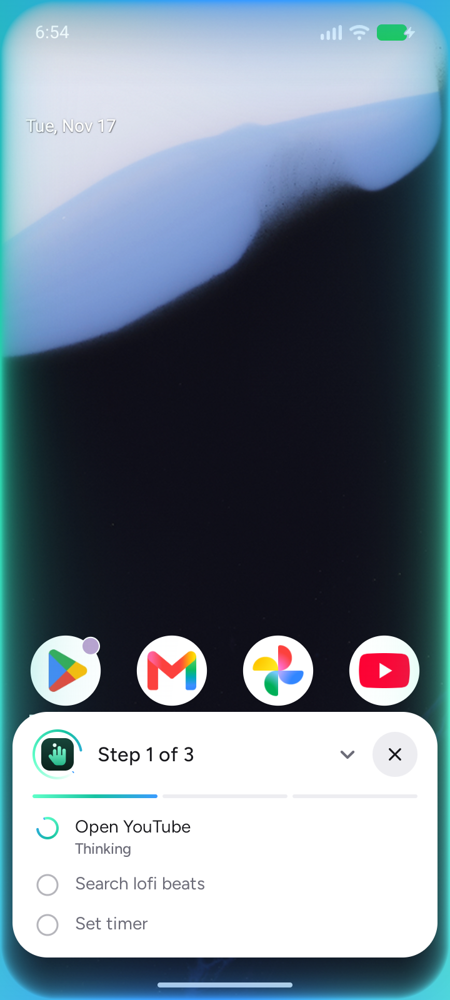 | 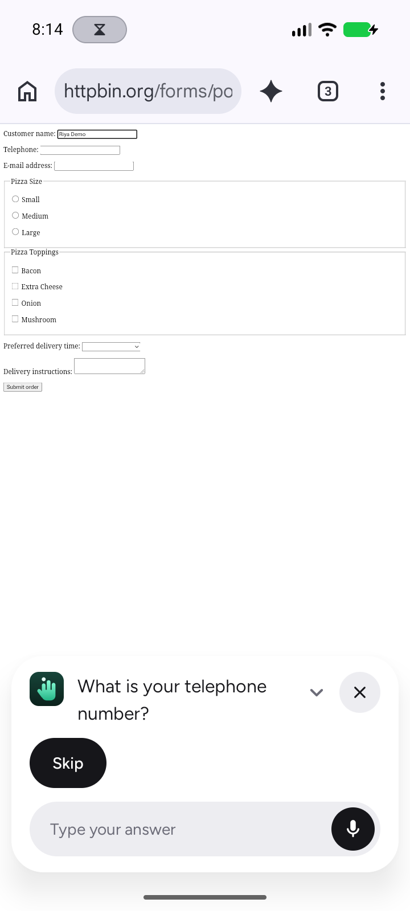 | 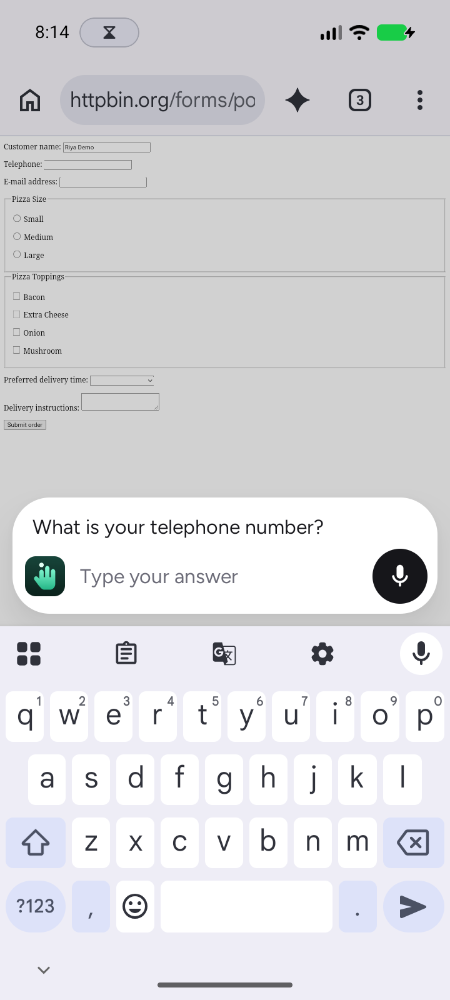 | 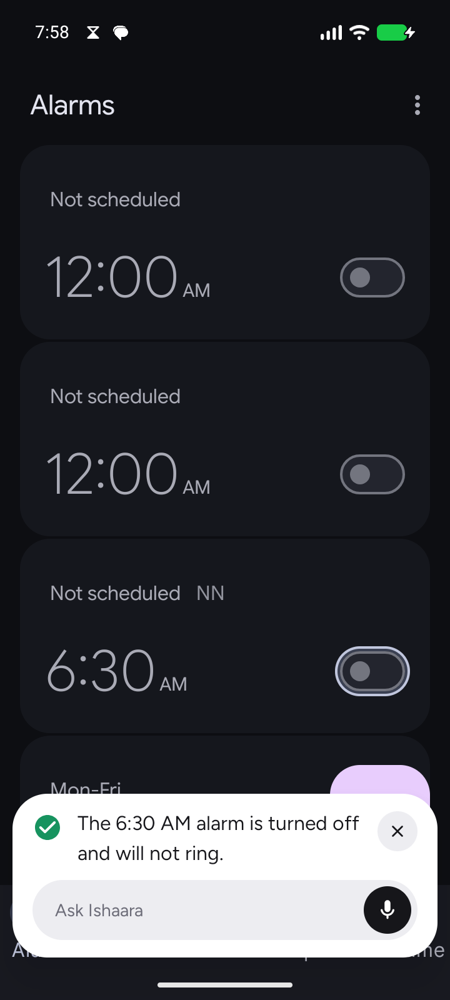 |

| Setup | Settings |
|:---:|:---:|
| 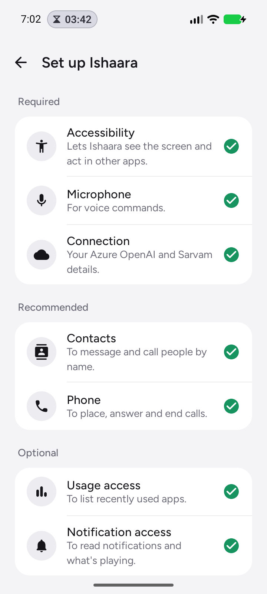 | 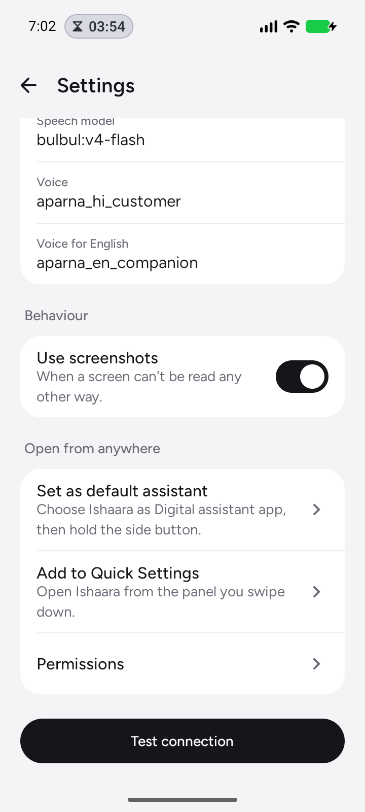 |

### Real apps

| Home | Checking Blinkit | Cheapest named | Uber fares |
|:---:|:---:|:---:|:---:|
| 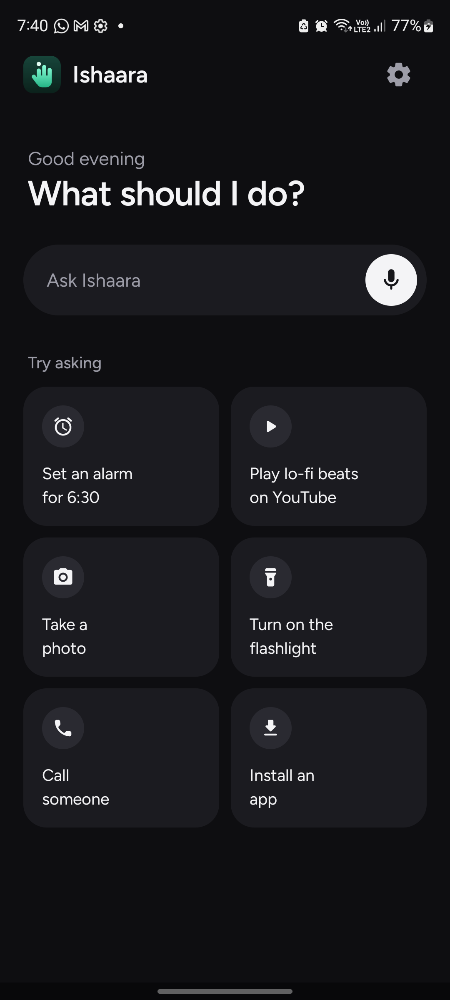 | 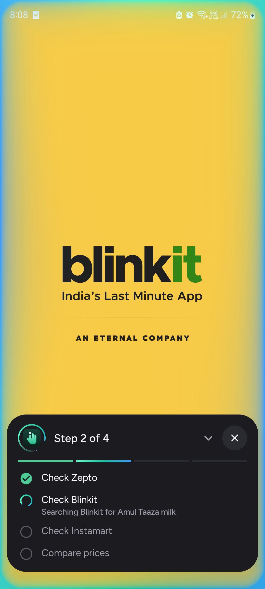 | 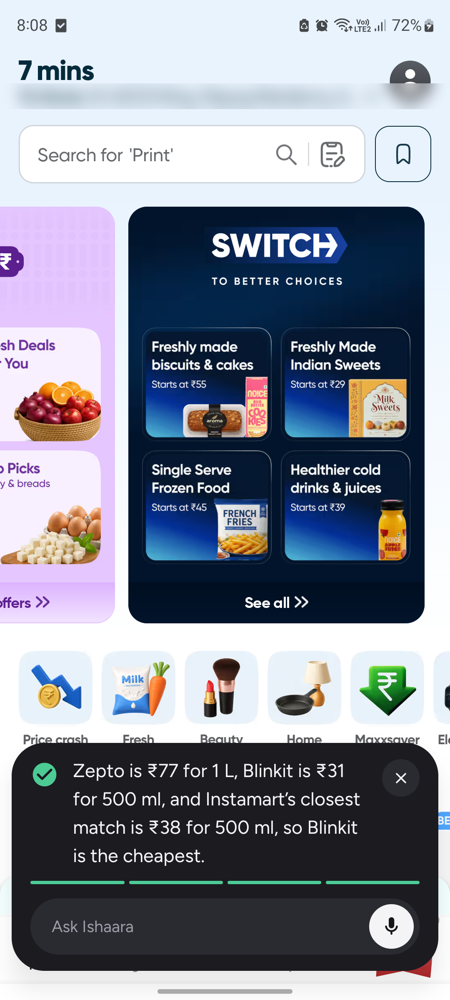 | 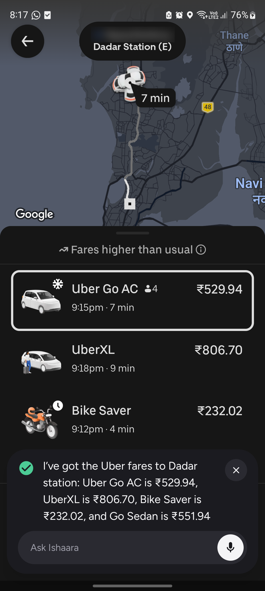 |

Addresses in the screenshots are blurred.

## Opening the chat bar

- **From anywhere, with the assistant shortcut:** in Ishaara, go to **Settings → Set as default assistant** and pick Ishaara as the digital assistant app. Then, depending on your phone, hold the side button or swipe up from a bottom corner.
- **From Quick Settings:** in Ishaara, go to **Settings → Add to Quick Settings**. Then swipe down from the top of the screen and tap the **Ishaara** tile.
- **After a task:** the result card keeps an **Ask Ishaara** bar, so you can type or speak the next command straight away.
- **In the app:** the **Ask Ishaara** bar on the home screen. Tap the mic to speak.

## How it works

### Reading the screen

Ishaara sees a screen the way a screen reader does. The accessibility service turns whatever is showing into a numbered list of elements: buttons, text fields, labels, switches and lists. The agent then answers with exactly one action, such as tapping element 9. When a screen can't be read that way, for example a game or a drawing canvas, a screenshot is used instead.

<p align="center">
  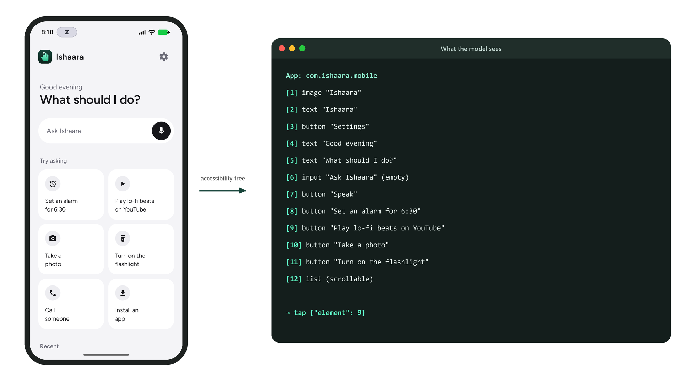
</p>

### Plan, act, verify, retry

1. **Plan.** The planner turns the command into 1 to 8 tasks. Each task has a success check that can be seen on the phone, such as "an alarm is set for 6:30 AM".
2. **Act.** For each task, the executor reads the screen and picks one action per step. That's either a one-step shortcut such as `set_alarm` or `whatsapp_send`, or a screen action such as `tap`, `type_text` or `scroll`. Every action passes the safety policy before it runs.
3. **Verify.** When the executor says a task is done, a separate verifier compares the success check with the actual screen.
4. **Retry.** If the check fails, the task is retried, up to 3 times, with the reason attached. Results are carried forward, so a later task can use them: for example, the "Compare prices" task uses the prices found by earlier tasks.

<p align="center">
  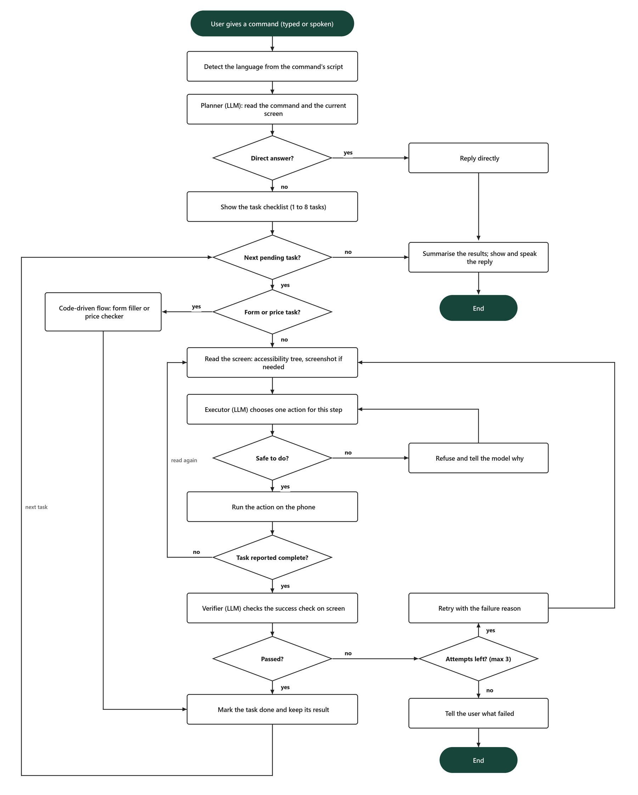
</p>

## Multi-agent design

Ishaara isn't one AI doing everything. Five specialised agents each do one job, with their own instructions and their own small set of tools. An **orchestrator** (the agent session and loop) hands each task to the right agent, applies the safety policy to every action, retries failures and passes results between tasks on a shared task board.

<p align="center">
  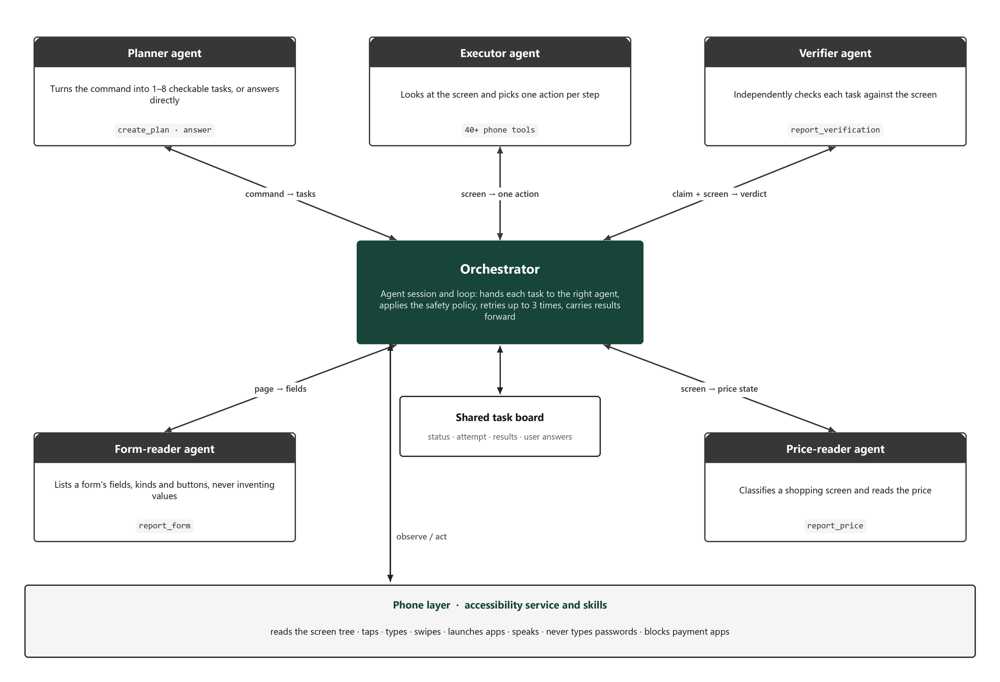
</p>

| Agent | Sees | Answers with | Job |
|---|---|---|---|
| **Planner** | The command, the current screen, the last few exchanges | `create_plan` or `answer` | Splits the command into checkable tasks, or answers directly when nothing needs doing on the phone |
| **Executor** | The current task and the numbered screen | One of 40+ phone tools | Takes the next single step toward the task |
| **Verifier** | The task's success check, what the executor claims, the actions taken and the screen | `report_verification` | Independently passes or fails the task. It never sees the executor's reasoning, only the result |
| **Form reader** | A form on screen and the answers so far | `report_form` | Lists the fields, their kinds, options and buttons, and never invents values |
| **Price reader** | A shopping app's screen and the item | `report_price` | Says what the screen is (results, address picker, pop-up, loading) and reads the price |

Splitting the work this way keeps each agent simple and checkable. The verifier catches the executor's mistakes. And for forms and prices, code drives the flow while the readers only describe the screen. That's why a form is never filled with made-up values, and a price is never credited to the wrong app.

<details>
<summary><b>Form-filling flow</b></summary>
<p align="center">
  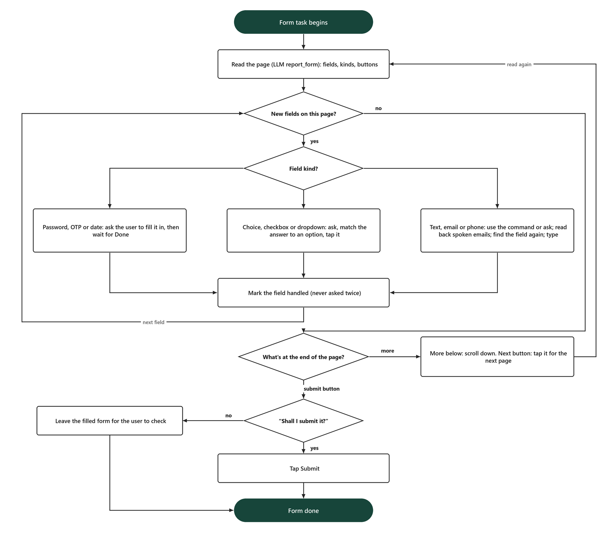
</p>
</details>

<details>
<summary><b>Price-checking flow</b></summary>
<p align="center">
  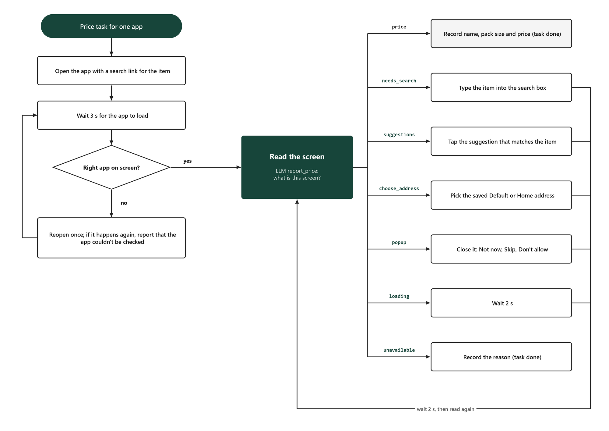
</p>
</details>

## Multilingual

Ishaara works in **English and 10 Indian languages**: Hindi, Marathi, Gujarati, Tamil, Telugu, Bengali, Kannada, Malayalam, Punjabi and Odia. It replies in the language you used, on screen and out loud.

<p align="center">
  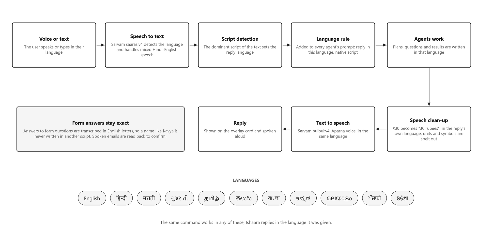
</p>

1. **Listening.** Speech is recognised with Sarvam's `saaras:v4`, which detects the language and handles mixed Hindi-English speech, the way people actually talk. It listens for when you stop speaking, then transcribes the whole recording for better accuracy.
2. **Choosing the reply language.** The dominant script of the command (Devanagari, Gujarati, Tamil and so on) sets the reply language. An English command always gets an English reply.
3. **Every agent follows it.** A language rule is added to every agent's instructions, so plans, questions and results are all written in that language, in its own script.
4. **Speaking.** Before the reply is spoken, symbols and units are turned into words: "₹30" becomes "30 rupees", and "500 ml" becomes "500 millilitres". It's then spoken with Sarvam's `bulbul:v4` Aparna voice.
5. **Exact answers for forms.** Answers to form questions are transcribed in English letters, so a name like "Kavya" is never typed in another script. Spoken email addresses ("kavya at gmail dot com") are cleaned up and read back for you to confirm.

## Diagrams

More diagrams, including the use case and data model (ER) diagrams, are in [docs/diagrams/](docs/diagrams/).

## Safety

- Payment and banking apps are blocked.
- Ishaara never types into password fields and never sends them to the model. For passwords, card numbers and one-time codes, it asks you to fill them in yourself.
- Calls are answered, ended or placed only when your own words asked for it. A call that rings during another task is left alone.
- Sending, buying, installing, deleting and calling are marked irreversible. They are confirmed before they happen and are never repeated by a retry.
- Text on screen is treated as data, never as instructions, so a web page can't take control of Ishaara.
- System permission prompts are left for you to answer.

## Tech stack

| Area | Used |
|---|---|
| Language | Kotlin 2.3 |
| UI | Jetpack Compose (Material 3), with AGSL shaders for the edge glow |
| Phone control | AccessibilityService: screen tree, gestures, global actions, screenshots |
| Overlay | Accessibility overlay windows with a Compose UI |
| AI | Azure OpenAI chat completions with tool calling |
| Voice | Sarvam AI speech to text and text to speech |
| Networking | OkHttp, kotlinx.serialization |
| Storage | DataStore |
| Build | Gradle 9.1, Android Gradle Plugin 9.0, JDK 17 |
| Tests | JUnit 4 and kotlinx-coroutines-test: 159 unit tests |

## Requirements

- An Android phone with **Android 11 or newer**.
- To build it: **Android Studio** (recent version) with **Android SDK 36**. Android Studio includes JDK 17, which the build needs.

## Build and install

### Android Studio

1. Open this folder in Android Studio and let Gradle sync.
2. Connect your phone with USB debugging on, or start an emulator.
3. Press **Run**.

### Command line (Windows PowerShell)

```powershell
# Use the JDK that ships with Android Studio
$env:JAVA_HOME = "C:\Program Files\Android\Android Studio\jbr"

# Run the unit tests and build the debug APK
.\gradlew.bat testDebugUnitTest assembleDebug

# Install on the connected phone
& "$env:LOCALAPPDATA\Android\Sdk\platform-tools\adb.exe" install -r app\build\outputs\apk\debug\app-debug.apk
```

### Command line (macOS or Linux)

```bash
./gradlew testDebugUnitTest assembleDebug
adb install -r app/build/outputs/apk/debug/app-debug.apk
```

The APK is written to `app/build/outputs/apk/debug/app-debug.apk`.

### Release build

A release build contains no credentials. It's signed with the key named in a git-ignored `keystore.properties` file in the project root:

```properties
storeFile=ishaara-release.jks
storePassword=...
keyAlias=ishaara
keyPassword=...
```

```powershell
.\gradlew.bat assembleRelease
# output: app\build\outputs\apk\release\app-release.apk
```

### Useful commands

```powershell
.\gradlew.bat testDebugUnitTest      # unit tests only
.\gradlew.bat assembleDebug          # build only
.\gradlew.bat clean                  # remove build output
.\gradlew.bat --stop                 # stop Gradle's background process to free memory
adb devices                          # check that the phone is connected and authorised
adb logcat -s Ishaara:D              # watch the agent's plan, steps and checks live
```

If `adb devices` shows **unauthorized**, accept the "Allow USB debugging?" prompt on the phone and tick **Always allow from this computer**.

## First run

1. Open **Ishaara** and follow the **Set up Ishaara** checklist:
   - **Accessibility**: turn on Ishaara under Installed apps. This lets it see and use other apps.
   - **Microphone**: choose **Allow only while using the app**, not "Only this time". Otherwise Android takes the permission back when Ishaara is in the background, and the command bar disappears.
   - **Connection**: complete it from Settings.
   - Recommended: **Contacts** and **Phone**, for messages and calls.
   - Optional: **Usage access** and **Notification access**, for recent apps, notifications and media.
2. On Android 13 and newer, a sideloaded app may show **"Restricted setting"** when you turn on Accessibility. Open **App info → ⋮ → Allow restricted settings**, then try again.
3. Set up a shortcut to open the chat bar from anywhere: see [Opening the chat bar](#opening-the-chat-bar).

Then type or speak a command on the home screen, or from the chat bar over any app.

## Things to try

| Command | What happens |
|---|---|
| `Compare the price of Amul Taaza milk on Zepto, Blinkit and Instamart` | Checks each app and says which is cheapest |
| `Show me Uber fares to Dadar station` | Sets the destination and reads out every ride with its fare; books nothing |
| `Open Google and YouTube in split screen` | Puts both apps on screen together |
| `Fill this form on my screen` | Asks for each field one by one, then asks before submitting |
| `Search YouTube for lofi beats and play the first video` | Searches, skips ads, plays the first real result |
| `Turn off my 6:30 alarm` | Opens the Clock app and switches that alarm off |
| `What's on my screen?` | Describes the current screen |
| `Send hi to Rahul on WhatsApp` | Finds the contact, sends the message, confirms it went |
| `YouTube पर कोई गाना चला दो` | Plays a song and replies in Hindi |

## Project structure

```
app/src/main/java/com/ishaara/mobile/
├── core/        The agent in plain Kotlin, with no Android imports, so it can be unit tested
│   ├── AgentLoop.kt       plan → act → verify → retry
│   ├── AgentSession.kt    one command at a time; questions and answers; conversation memory
│   ├── FormFiller.kt      fills forms with the user, one field at a time
│   ├── PriceChecker.kt    opens shopping apps and reads prices
│   ├── Prompts.kt         instructions for the planner, executor, verifier and readers
│   ├── ToolSchema.kt      the tools the model can call
│   ├── SafetyPolicy.kt    blocked apps, password protection, call guard, irreversible actions
│   └── model/             tasks, actions, screen elements, events
├── service/     Accessibility service: reads the screen tree, taps, types, swipes, screenshots
├── skills/      One-step shortcuts: apps, calls, messages, camera, clipboard, split screen, ...
├── overlay/     Floating chat bar, task checklist and animated edge glow
├── input/       The chat bar for typing and voice
├── voice/       Speech to text and text to speech
├── llm/         Language model client
├── data/        Settings and command history
└── ui/          App screens (home, setup, settings) and the design system

app/src/test/    Unit tests for the agent, form filler, price checker, safety policy, parsers and voice
docs/
├── Ishaara-Project-Report.docx   project report
├── diagrams/                     architecture, agents, flowcharts, sequence, ER and deployment diagrams
├── screenshots/                  app screenshots
└── device-test-results.md        results from real devices
```

## Known limits

- **Android only.** iOS doesn't allow one app to control another.
- **No voice on calls.** Ishaara can answer a call and turn on the speaker when you ask, but it can't talk on the call itself.
- **Real-time games.** Each step takes 1–3 seconds, which is too slow for fast games.
- **Some screens are hidden.** Permission prompts and some secure screens can't be read by accessibility services, so Ishaara asks you to handle them.
- **Battery savers.** Aggressive battery saving on some phones (Xiaomi, Oppo, Vivo) can stop the accessibility service. Excluding Ishaara from battery optimisation helps.

## Tests

```powershell
.\gradlew.bat testDebugUnitTest
```

There are 159 unit tests. They cover:
- planning, the act–verify–retry loop and retries;
- safety rules, including leaving a ringing call alone during an unrelated task;
- form filling and price checking;
- finding the same element again after the screen changes;
- language detection and text cleanup for speech.

Results from real devices are in [docs/device-test-results.md](docs/device-test-results.md).
